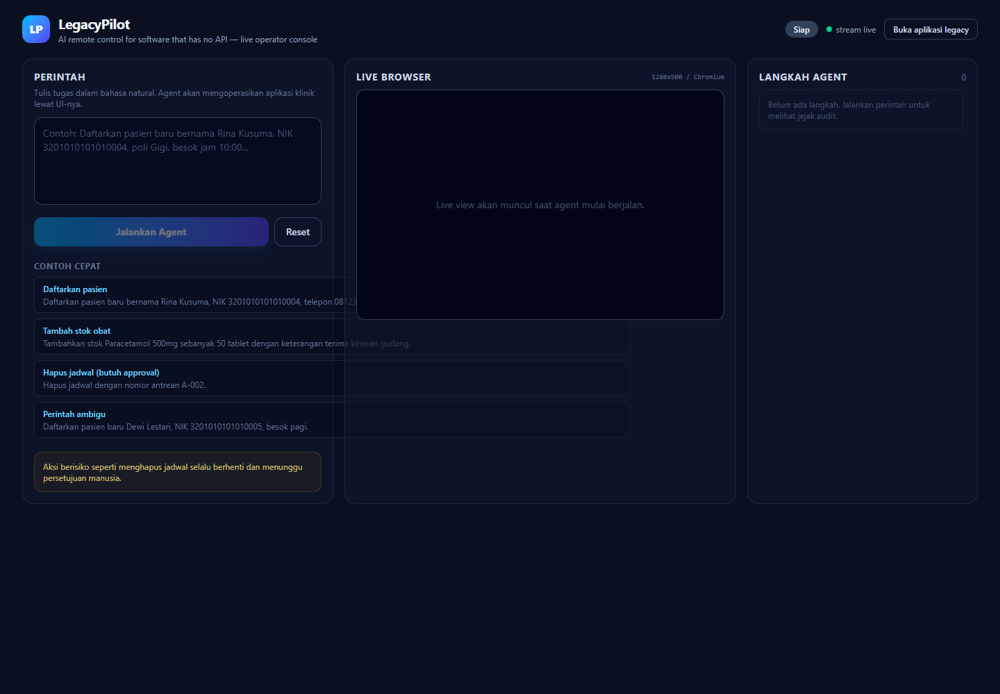
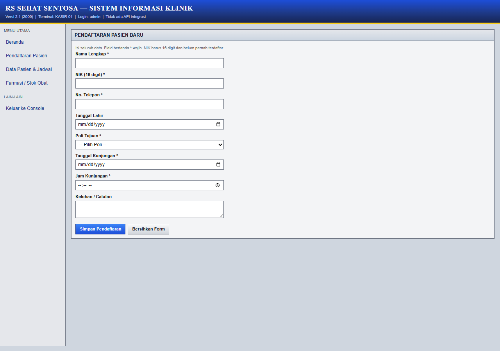
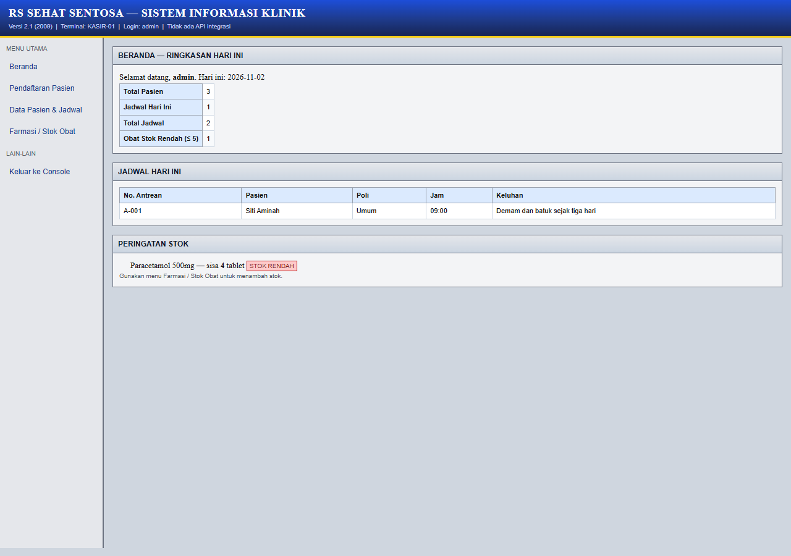

# LegacyPilot

**An AI remote control for software that has no API.** Describe a task in natural language and an agent operates the real application for you — with human approval for anything risky.

Built for the **Remote Control AI** online hackathon (Devpost, November 2026).

---

## The problem

Clinics, warehouses, and government offices still run critical software that has no integration API. Staff copy data between screens by hand. Traditional RPA helps, but its scripts break whenever the UI changes, and building an integration is often more expensive than the manual work.

## What it does

LegacyPilot ships with a deliberately old-fashioned **clinic information system** (patient registration, schedules, pharmacy stock). The app has no integration API and looks like software from 2009.

You type a command such as:

> "Daftarkan pasien baru bernama Rina Kusuma, NIK 3201010101010004, poli Gigi, besok jam 10:00, keluhan sakit gigi."

An AI agent then:

1. Reads the current screen (visible text + interactive elements).
2. Chooses one constrained action at a time: `click`, `fill`, `select`, `scroll`, `wait`.
3. Fills the form, handles validation errors, and verifies the confirmation.
4. Asks a human when required data is missing or ambiguous.
5. Pauses for explicit approval before destructive actions such as deleting a schedule.
6. Finishes with a summary and a complete audit timeline.

You watch everything live: the browser is streamed frame-by-frame to the console, and every action is listed in the audit panel.

## Why it is different

- **The AI acts, not chats.** The LLM is the operator, not a text generator bolted onto a dashboard.
- **No API required.** It works through the same UI a human uses.
- **Contained toolset.** The model cannot run shell commands or make arbitrary HTTP calls; it can only interact with visible page elements.
- **Human-in-the-loop by design.** A server-side guardrail intercepts destructive clicks even if the model forgets to ask.
- **Auditable.** Every step, argument, and result is recorded.

## Screenshots







## Architecture

```
Next.js console (React)
  |  POST /api/agent/start        command
  |  GET  /api/agent/stream       SSE: state, steps, live frames, approval requests
  |  POST /api/agent/respond      approve / deny / answer
  v
Agent runner (server singleton)
  observe  -> DOM snapshot (text + interactive refs)
  decide   -> LLM tool call via OpenRouter
  act      -> Playwright action on the ref
  verify   -> next snapshot
  |
  | CDP Page.startScreencast (JPEG frames)
  v
Headless Chromium  --->  Mock legacy clinic app (/legacy)
```

The app, the agent, and Chromium run inside a single container. Real-time communication uses Server-Sent Events so it works without a separate WebSocket server.

## Tech stack

- **Next.js 16** (App Router, Turbopack) and **React 19**
- **TypeScript**
- **Tailwind CSS 4**
- **Playwright** (Chromium) for browser control
- **Chrome DevTools Protocol** screencast for the live view
- **Server-Sent Events** for streaming state and frames
- **OpenRouter** with tool calling for the planning step
- **Docker** for deployment

## Getting started

### Prerequisites

- Node.js 20+ (tested with Node 24)
- An OpenRouter API key
- Google Chrome (Windows/macOS) or the Playwright Chromium browser

### Local setup

```bash
npm install

# Windows PowerShell
Copy-Item .env.example .env.local

# macOS / Linux
cp .env.example .env.local
```

Edit `.env.local` and set at least:

```dotenv
OPENROUTER_API_KEY=sk-or-v1-...
OPENROUTER_MODEL=openai/gpt-4o-mini
```

**Model and rate limits:** each run makes roughly 5–12 LLM calls (one per action). OpenRouter free models are capped at 50 requests per day per account, which is only about 5–8 demo runs. For a live demo or judging, add credits to the account or use a low-cost paid model such as `openai/gpt-4o-mini`. Any OpenRouter model with tool calling works.

Then:

```bash
npm run dev
```

- Console: http://localhost:3000
- Legacy clinic app: http://localhost:3000/legacy

On Windows and macOS the agent uses your installed Chrome automatically. On Linux, or if Chrome is missing, install the bundled browser:

```bash
npm run install:browser
```

### Environment variables

| Variable | Default | Purpose |
|---|---|---|
| `OPENROUTER_API_KEY` | required | OpenRouter key (server-side only) |
| `OPENROUTER_MODEL` | required | Tool-calling capable model ID |
| `AGENT_MAX_STEPS` | `25` | Hard cap on agent actions per run |
| `AGENT_TIMEOUT_MS` | `180000` | Wall-clock limit per run |
| `APP_URL` | auto `http://127.0.0.1:3000` | Base URL the headless browser visits |
| `BROWSER_CHANNEL` | `chrome` on win32, bundled Chromium elsewhere | Playwright browser channel |

### Try these commands

1. **Happy path** — register a patient with all required fields.
2. **Ambiguous request** — register someone "besok pagi" without phone, poli, or time. The agent asks you.
3. **Destructive action** — "Hapus jadwal A-002." The agent pauses for approval.
4. **Inventory** — "Tambahkan stok Paracetamol 500mg sebanyak 50 tablet."

Use the **Reset** button to restore the seed data and stop a run. The start endpoint is rate-limited to 20 runs per hour per IP to protect the public demo from abuse.

## Testing

With the production server running:

```bash
npm run build
npm start
# in another terminal
npm run test:e2e
```

`scripts/e2e.mjs` drives the console in headless Chrome, runs a stock update, verifies that live frames and audit steps render, then runs a destructive action and approves it. It takes roughly 90 seconds and uses your OpenRouter credits.

## Docker

```bash
docker build -t legacy-pilot .

docker run --rm -p 3000:3000 \
  -e OPENROUTER_API_KEY=sk-or-v1-... \
  -e OPENROUTER_MODEL=openai/gpt-4o-mini \
  legacy-pilot
```

The image is based on the official Playwright image, so Chromium and its system dependencies are already included. It needs roughly 1 GB of RAM to run Chromium comfortably; a 512 MB free tier may be unstable.

## Deploy

A `render.yaml` blueprint is included for Render (Docker runtime, health check at `/api/agent/state`). Set `OPENROUTER_API_KEY` in the dashboard as a secret. Fly.io, Railway, or any Docker host works the same way — expose port `3000` and provide the same environment variables.

## Project structure

```
app/
  page.tsx                    Agent console
  legacy/                     Mock clinic application
  api/agent/                  start, stream (SSE), respond, reset, state
  api/legacy/                 register, stock, delete, data, reset
lib/agent/
  runner.ts                   Run lifecycle, SSE events, approvals
  llm.ts                      OpenRouter tool calling + retries
  tools.ts                    Constrained tool schema + executor
  snapshot.ts                 Accessible DOM snapshot with refs
  browser.ts                  Chromium lifecycle + CDP screencast
lib/legacy/
  store.ts                    In-memory clinic data + validation
  types.ts                    Shared types (client-safe)
```

Data is stored in memory and resets when the server restarts. This is intentional for a demo.

## Safety and limitations

- The clinic app, patients, and stock records are fictional.
- Destructive button labels are intercepted by the server and require human approval; the model cannot bypass this by skipping its own approval call.
- Page content is treated as untrusted input, and the agent can only use a small allowlist of UI actions.
- The agent operates only same-origin `/legacy` pages.
- This is a hackathon prototype, not a medical or production system. Do not use it with real patient data.

## License

MIT
